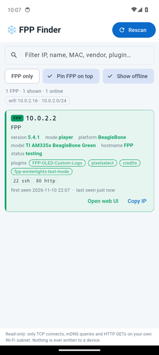
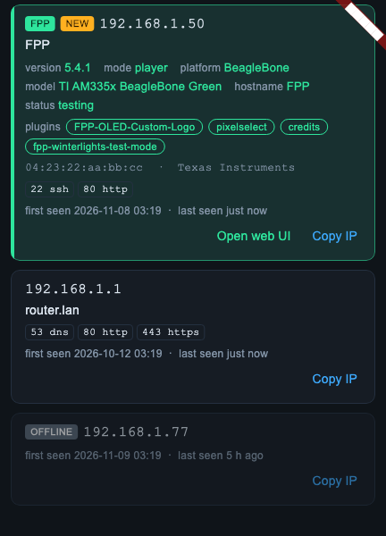

# FPP Finder — mobile (Android + iOS)

The phone version of FPP Finder: it scans **your phone's own Wi-Fi network** and highlights
**Falcon Player (FPP) controllers** — version, mode, platform, hostname, plugins — with the same
green rows, `FPP only` toggle, `NEW` badge, first/last seen, auto-rescan, *Open web UI* and *Copy IP*
as the desktop app. Works fully offline. **Read-only: it never writes to or changes any device.**

<p align="center">


</p>

*Left: the release APK running on a CI Android emulator against a fake FPP serving the recorded FPP 5.4.1 responses. Right: dark-mode card rendering from `flutter test`. Neither is a photo of a real phone or a real controller.*

## Install

### Android (sideload the APK)
1. Download `fpp-finder-<version>-android.apk` from the [latest release](https://github.com/joeskolengaden/fpp-finder/releases/latest) on your phone.
2. Open it. Android asks to allow installs from that app (Chrome / Files): allow it once.
3. Open **FPP Finder** while connected to the same Wi-Fi as your controllers.

The APK is signed with the project's own release key (kept in GitHub Actions secrets), so later
releases install **over** the old one and keep your first-seen history.
Play Protect may say "unknown developer" — that is expected for a sideloaded app.

### iPhone / iPad
Apple only runs apps signed by an Apple-issued certificate, so there is no "just open it" download:

| Option | Cost | What you get |
|---|---|---|
| **Unsigned `.ipa`** via [AltStore](https://altstore.io) or [Sideloadly](https://sideloadly.io) | free Apple ID | The release file `fpp-finder-<version>-ios-unsigned.ipa`. The tool re-signs it with *your* Apple ID and installs it. **Free-account apps expire after 7 days** and must be refreshed (AltStore does this automatically while its companion app runs on your Mac/PC on the same Wi-Fi). |
| **Simulator `.app`** (`…-ios-simulator.app.zip`) | free, needs a Mac with Xcode | Unzip, then `xcrun simctl install booted Runner.app`. Only runs in the iOS Simulator, never on a real iPhone. |
| **TestFlight / App Store** | paid Apple Developer Program (US$99/yr) | A normal install link (TestFlight: 90-day builds, up to 10 000 testers). See below. |

Sideloadly quick steps: install Sideloadly → plug in the iPhone (trust the computer) → drag the `.ipa` in →
enter your Apple ID → *Start*. On the phone: *Settings → General → VPN & Device Management →* trust your Apple ID,
and on iOS 16+ enable *Developer Mode*.

On first launch iOS asks to allow **Local Network** access — say **Allow**, otherwise iOS silently blocks the
scan (you will see "No devices").

#### What a TestFlight / App Store path would need (not set up here)
* An Apple Developer Program membership and an App Store Connect app record for the bundle id (`dev.fppfinder.fppFinder`, change it to one you own).
* A distribution certificate + provisioning profile (or App Store Connect API key with automatic signing) stored as GitHub secrets.
* In CI: `flutter build ipa --release` (with an `ExportOptions.plist`) instead of `--no-codesign`, then upload with `xcrun altool`/`fastlane pilot`/the `upload-testflight-build` action.
* App Store review: privacy details ("Data not collected"), the `NSLocalNetworkUsageDescription` text, and a reviewer note that the app talks to LAN devices.

## How it finds devices (phones can't read ARP or open raw sockets)
1. **Your network** — the Wi-Fi IPv4 address + netmask (`network_info_plus`), falling back to other private IPv4
   interfaces. Never scans outside it; a subnet larger than a /24 (e.g. a /16) is **capped to the phone's own /24**.
2. **mDNS / Bonjour** — `_fppd._udp`, `_http._tcp`, `_wled._tcp` browse plus `fpp.local` and previously-seen `<name>.local`.
3. **TCP sweep** of every host in that subnet on ports 80, 443, 22, 445, 8080 (a refused connection also proves a host is alive), then a
   16-port common-port check on the live ones.
4. **FPP probe** of hosts serving port 80 (or advertising `_fppd`): read-only `GET /api/fppd/version` decides FPP; for FPP hosts also
   `/api/fppd/status`, `/api/fppd/multiSyncSystems`, `/api/system/info`, `/api/plugin`, `/api/network/interface`.
5. **MAC / vendor** — only available for FPP devices, which report their own MAC through `/api/network/interface`; it is looked up in
   the bundled IEEE OUI table (~40 000 vendors, offline). Other devices show IP/name/ports only because iOS and Android 10+ do not let apps read the ARP table.
6. **History** — first-seen / last-seen (30 days) stored on the phone; `NEW` = first appeared in the latest scan (not on the very first scan).

Only TCP connects, mDNS queries and HTTP `GET`s are ever sent (`lib/net/probe.dart` has the single HTTP entry point, and
`test/net_test.dart` asserts a probe sends nothing but `GET`).

### Platform plumbing
| | Android | iOS |
|---|---|---|
| Cleartext HTTP to LAN devices | `usesCleartextTraffic="true"` + `network_security_config.xml` | `NSAppTransportSecurity → NSAllowsLocalNetworking` |
| Local-network consent | none needed | `NSLocalNetworkUsageDescription` |
| Bonjour | `CHANGE_WIFI_MULTICAST_STATE` + a `MulticastLock` held only while scanning (`MainActivity.kt`) | `NSBonjourServices`: `_fppd._udp`, `_http._tcp`, `_wled._tcp` |
| Wi-Fi address / netmask | `ACCESS_WIFI_STATE` | — |
| Not requested | location, `NEARBY_WIFI_DEVICES` (the app never reads the SSID) | — |

## Why Flutter
Needs: one codebase for both phones, raw TCP sockets, mDNS, local storage, and native-feeling UI, built in CI without owning a Mac.
Flutter gives all of it from plain Dart (`dart:io` sockets + HTTP, the first-party `multicast_dns` package), the logic is a straight port of the
desktop JS (so the unit tests port 1:1), and `flutter build apk` / `flutter build ios --no-codesign` are one-liners in GitHub Actions.
Capacitor/React Native would have needed extra native plugins for raw TCP connects, mDNS and multicast locking — more moving parts, more native code to maintain.

## Layout
```
lib/core/    pure Dart (no I/O): FPP classification, subnet math, OUI lookup, history merge — unit-tested
lib/net/     probes (HTTP GET, TCP connect), mDNS, interface detection, scan orchestration
lib/app/     ScanController (state, filters, auto-rescan, persistence), Android multicast-lock channel
lib/ui/      Material 3 UI (dark/light), device card, home page
test/        unit + widget tests; fixtures are the same recorded FPP 5.4.1 responses as the desktop app
tool/        icon generator, fake FPP server used by the CI emulator smoke test
```

## Develop
```bash
cd mobile
flutter pub get
flutter analyze && flutter test
flutter run            # on a connected phone / emulator
```
Tested with Flutter 3.47.9 (pinned in CI). `flutter test` runs 40+ tests: classification against the recorded fixtures, subnet enumeration
(/24, /25, /16 and /22 caps, link-local), history merge (NEW / offline / MAC upgrade / 30-day pruning), `probeFpp` against a local fake FPP
HTTP server (GET-only assertion), TCP open/closed classification, and widget tests of the device card.

## Build
`.github/workflows/mobile.yml` (repo root) runs on every change to `mobile/`:
* **test** — `flutter analyze` + `flutter test`
* **android** — release-signed APK, then `apksigner verify`, `aapt2` badging/permission checks, cleartext/network-config checks
* **android-emulator** — installs the APK on an Android 34 emulator, serves a fake FPP (recorded responses) on the runner, launches the app, screenshots it and checks the fake FPP was probed with GETs only
* **ios** — `flutter build ios --release --no-codesign` → unsigned `.ipa`; simulator `.app` zip; plist/arch checks; simulator launch + screenshot

Signing: the Android release key is stored as the repository secrets `ANDROID_KEYSTORE_BASE64`, `ANDROID_KEYSTORE_PASSWORD`,
`ANDROID_KEY_ALIAS`, `ANDROID_KEY_PASSWORD`. Forks/PRs have no secrets and get a throw-away key generated in the job (installable, but not updatable).
Never commit `key.properties` or a keystore (they are git-ignored).

To publish a release by hand: download the `fpp-finder-android` / `fpp-finder-ios` artifacts from the run, then
`gh release upload vX.Y.Z <files> --clobber`.

## What has and has not been verified
Verified in CI (run on every change):
* `flutter analyze` clean; unit + widget tests pass on Linux (classification fixtures, subnet math, history merge, GET-only fake-FPP probe).
* Android APK: signed with the project key, `apksigner verify` passes (v2 scheme), manifest permissions / cleartext config present, installs and launches on an Android 14 x86_64 emulator, finds and classifies a fake FPP on the emulator's own /24, no crash in logcat.
* iOS: builds with `--no-codesign`; the `.ipa` has the expected plist keys (`NSLocalNetworkUsageDescription`, `NSBonjourServices`, `NSAllowsLocalNetworking`), an arm64 binary and **no signature** (so AltStore/Sideloadly can re-sign it); the simulator build installs and renders on an iPhone simulator.

**Not verified** (no phone available): a run on a physical Android phone or iPhone; real mDNS discovery (the emulator has no multicast peers); iOS scanning/Local-Network permission behaviour and a scan result on iOS; installing the unsigned `.ipa` through AltStore/Sideloadly; any real FPP controller; behaviour on Wi-Fi with client isolation.

## Limits / honest notes
* iOS needs Local Network permission; if it is denied the scan finds nothing.
* Wi-Fi networks with *client isolation* (many guest networks) hide other devices from the phone.
* A host that drops TCP and does not advertise over mDNS can't be seen (same as desktop without ARP).
* iPhone-on-cellular / VPN: only Wi-Fi/LAN interfaces are scanned.
